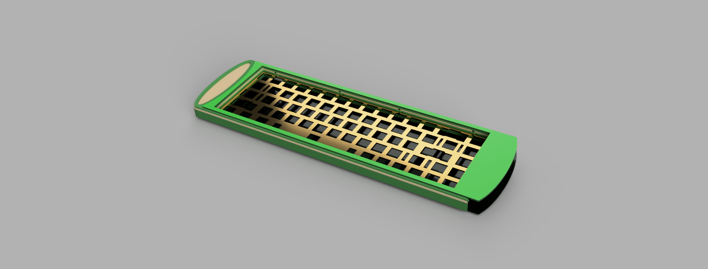
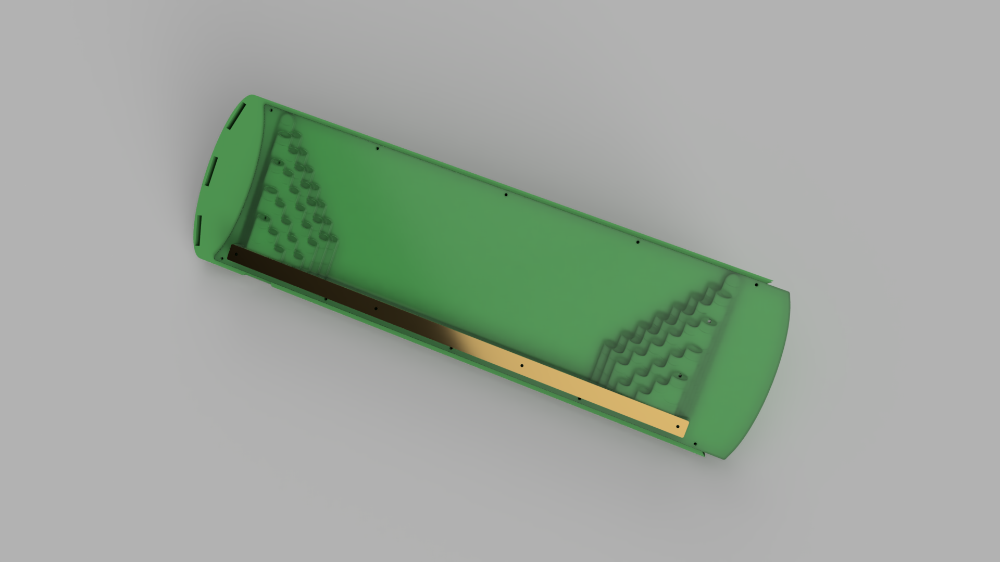
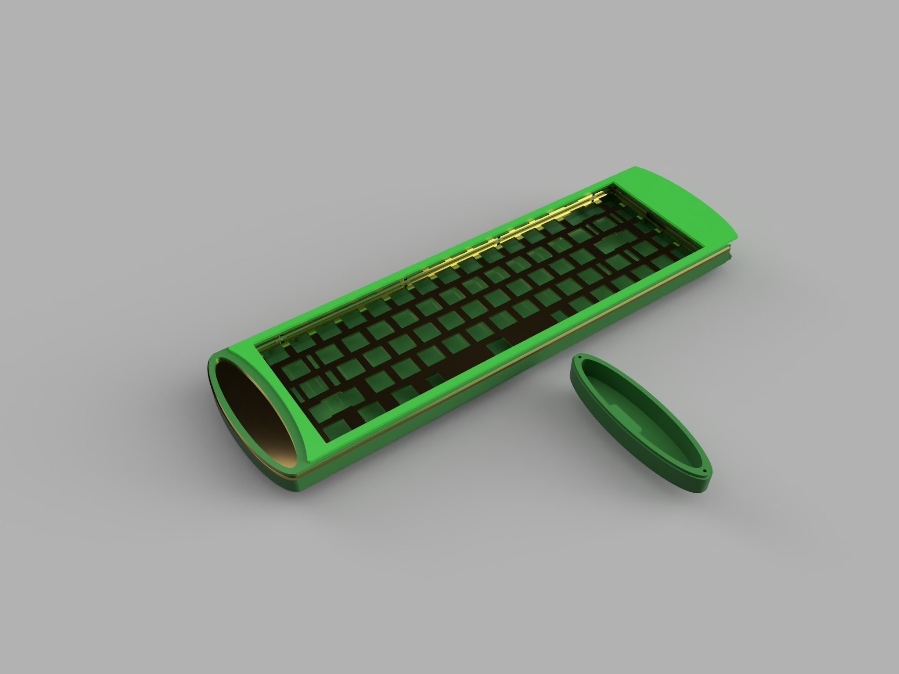
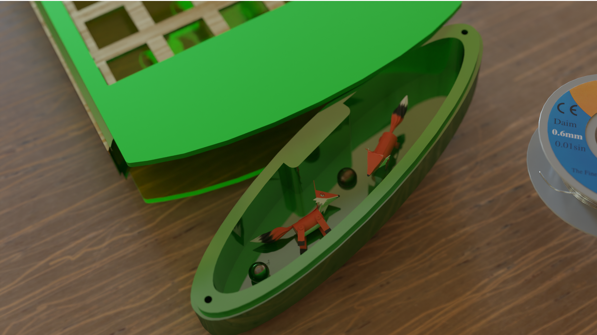
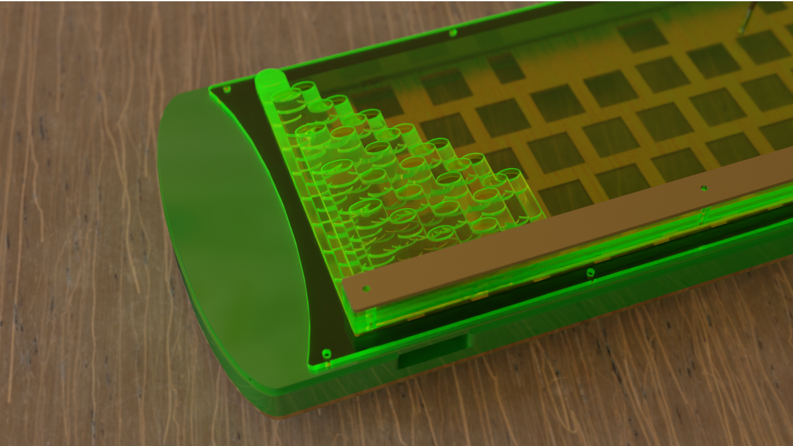
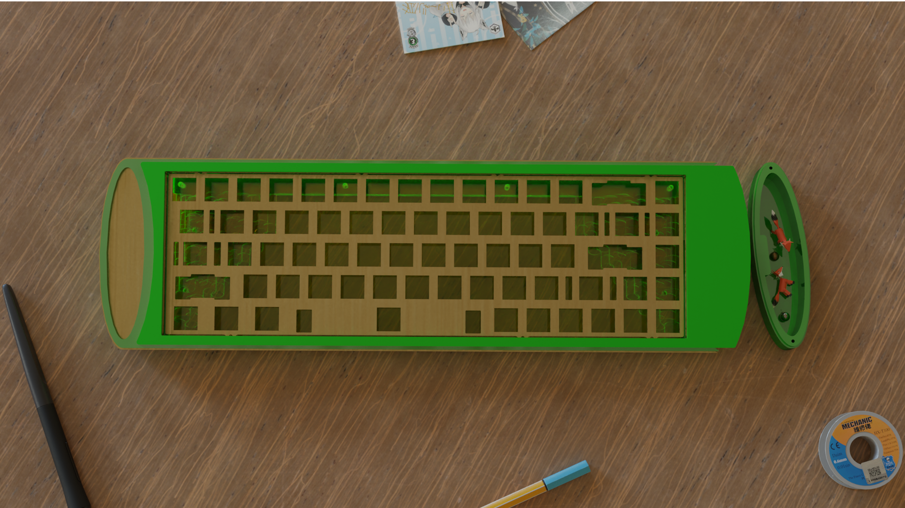
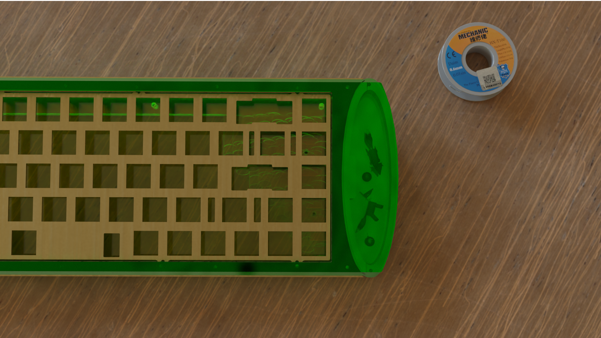
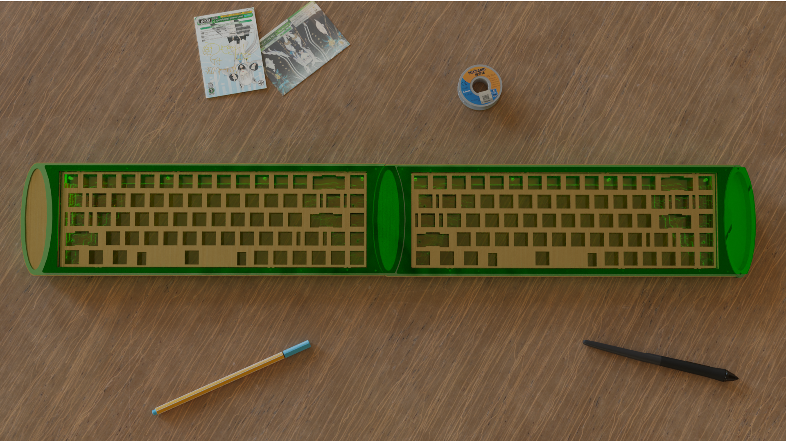

# 🎋 Baaambu65 & 60

> *"A top-mount laser-cut acrylic keyboard set with a bamboo log theme, built as a commission for streamer* ***Baaambu***."

<p align="center">
  
</p>

---

## ⚙️ Specs

| | |
|---|---|
| **Form factor** | 65% (Baaambu65) & 60% (Baaambu60) |
| **Type** | Commission — designed for streamer Baaambu |
| **Mount** | Top-mount sandwich |
| **Case** | Laser-cut acrylic |
| **Theme** | Bamboo log |
| **Plate** | Gravy plate with flexcuts (60% prototyped with a PLA printed plate) |
| **PCB** | Supports DZ65 & DZ60 |
| **Extras** | Detachable magnetic tray on the side of the case |

---

## 🔧 Development

- **CAD / modeling:** 3D modeling (Fusion 360)
- **Renders:** Blender

---

## 🎋 The Design

The Baaambu set is a commission project — a 65% and a 60% top-mount laser-cut acrylic keyboard with a **bamboo log** theme, designed for streamer Baaambu. Both boards support the DZ65 and DZ60 PCBs, and the case carries a **detachable magnetic tray** on the side. The 60% was prototyped with a PLA printed plate before the final gravy plate with flexcuts was made.

The design was modeled in 3D and rendered in November 2022. An early prototype (v1) was explored first, then the final v1.2 design was developed and rendered. A second colorway variant with a green acrylic / brass look was also explored.

### 🌿 Prototype — *v1*

<p align="center">
  
</p>

<details>
<summary>Angle view</summary>
<p align="center"></p>
</details>

<details>
<summary>Side profile</summary>
<p align="center"></p>
</details>

### 🌿 Final Design — *v1.2*

The final v1.2 design is the one that was built. The renders explore the full keyboard from multiple angles.

<p align="center">
  
</p>

<details>
<summary>Angle view</summary>
<p align="center"></p>
</details>

<details>
<summary>Full render — front</summary>
<p align="center"></p>
</details>

<details>
<summary>Full render — top</summary>
<p align="center"></p>
</details>

<details>
<summary>Full render — angle</summary>
<p align="center"></p>
</details>

<details>
<summary>Full render — side</summary>
<p align="center"></p>
</details>

<details>
<summary>Full render — back</summary>
<p align="center"></p>
</details>

<details>
<summary>Full render — close-up</summary>
<p align="center"></p>
</details>

<details>
<summary>Full render — detail</summary>
<p align="center"></p>
</details>

<details>
<summary>Full render — detail 2</summary>
<p align="center"></p>
</details>

<details>
<summary>Full render — detail 3</summary>
<p align="center"></p>
</details>

<details>
<summary>Full render — detail 4</summary>
<p align="center"></p>
</details>

#### 🔍 Alternate Colorway — *green acrylic / brass*

<details>
<summary>Alternate — top view</summary>
<p align="center"></p>
</details>

<details>
<summary>Alternate — angle</summary>
<p align="center"></p>
</details>

<details>
<summary>Alternate — side</summary>
<p align="center"></p>
</details>

<details>
<summary>Alternate — close-up</summary>
<p align="center"></p>
</details>

<details>
<summary>Alternate — detail</summary>
<p align="center"></p>
</details>

<details>
<summary>Alternate — detail 2</summary>
<p align="center"></p>
</details>

<details>
<summary>Alternate — detail 3</summary>
<p align="center"></p>
</details>

<details>
<summary>Alternate — detail 4</summary>
<p align="center"></p>
</details>

<details>
<summary>Alternate — detail 5</summary>
<p align="center"></p>
</details>

---

## 🔨 Development

- **November 5, 2022** — early prototype (v1) rendered.
- **November 6, 2022** — final v1.2 design rendered. Alternate colorway (green acrylic / brass) explored.

---

## 📁 Repository Structure

```
baaambu65 & 60/
├── README.md
├── dxf/
│   ├── baaambu65-cutting.dxf      # Final cutting file
│   ├── baaambu65-screw.dxf        # Screw variant
│   ├── baaambu65-screwless.dxf    # Screwless variant
│   ├── baaambu65-clean.dxf        # Clean version
│   ├── baaambu65-for-renders.dxf  # Render version
│   ├── baaambu60.dxf              # 60% full
│   └── baaambu60-for-render.dxf   # 60% render
└── images/
    └── renders/
        ├── proto/                 # Early prototype renders (v1, Nov 5 2022)
        ├── v1-2/                  # Final v1.2 renders (Nov 6 2022)
        └── v2/                    # Alternate colorway renders (green acrylic / brass)
```

---

*Built by [ReinTanto](https://github.com/ReinTanto). A commission — designed for streamer Baaambu.* 🎋
